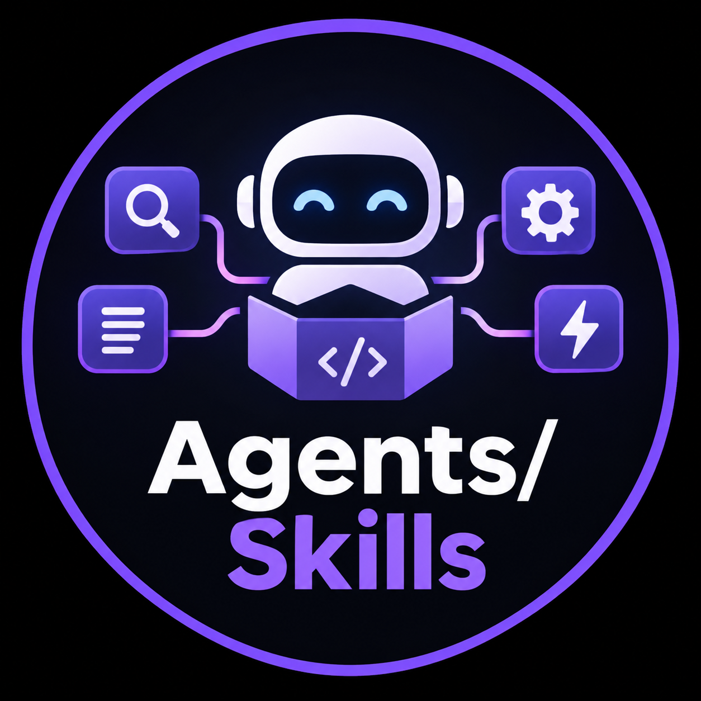

<a id="readme-top"></a>

<!-- PROJECT LOGO -->
<br />
<div align="center">
  

  <h3 align="center">Agent Skills</h3>

  <p align="center">
    A compilation of agents & skills for re-use across projects.
    <br />
    <a href="https://github.com/deepdivesecurity/agent-skills/issues/new?labels=bug&template=bug-report---.md">Report Bug</a>
    &middot;
    <a href="https://github.com/deepdivesecurity/agent-skills/issues/new?labels=enhancement&template=feature-request---.md">Request Feature</a>
  </p>
</div>

<!-- ABOUT THE PROJECT -->
## About The Project

A compilation of agents and agent skills to consume across projects.

<p align="right">(<a href="#readme-top">back to top</a>)</p>

<!-- GETTING STARTED -->
## Getting Started


### Prerequisites
- Agentic software to consume the agents or skills

### Installation
1. Clone the repo
   ```sh
   git clone https://github.com/deepdivesecurity/agent-skills.git
   ```

<p align="right">(<a href="#readme-top">back to top</a>)</p>
